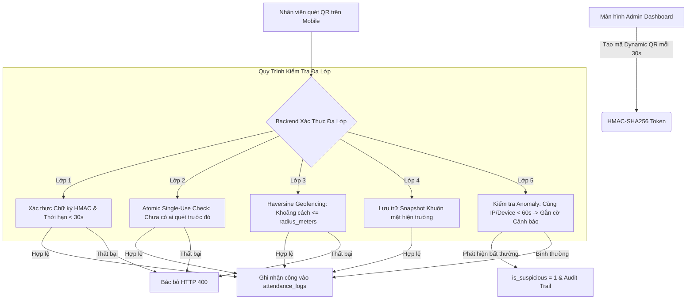

# HƯỚNG DẪN VẬN HÀNH HỆ THỐNG CHỐNG GIAN LẬN CHẤM CÔNG ĐA LỚP (MULTI-FACTOR ANTI-FRAUD ATTENDANCE SYSTEM) — SEDINCO HR

> **Tài liệu Kỹ thuật & Sổ tay Vận hành Dành cho Ban Giám Đốc, Bộ phận Kế toán & Quản trị Hệ thống**  
> *Phiên bản: 1.0 — Sedinco HR Enterprise Security Core*

---

## 1. TỔNG QUAN KIẾN TRÚC PHÒNG THỦ ĐA LỚP (DEFENSE-IN-DEPTH)

Hệ thống chấm công Sedinco HR được nâng cấp toàn diện lên kiến trúc **Multi-Factor Anti-Fraud Verification**, kết hợp 5 lớp bảo vệ chặt chẽ nhằm triệt tiêu hoàn toàn các hình thức gian lận:
1. **Lớp 1 — Time-based Dynamic QR (TOTP + Nonce)**: Thay thế hoàn toàn mã QR giấy tĩnh bằng màn hình hiển thị mã QR động thay đổi liên tục mỗi 30 giây, chống chụp ảnh gửi Zalo.
2. **Lớp 2 — Atomic Single-Use QR Session**: Token chỉ dùng được duy nhất 1 lần; nếu một nhân viên quét thành công thì token lập tức bị thu hồi, ngăn chặn tấn công Replay Attack.
3. **Lớp 3 — Server-side Geofencing (Haversine Formula)**: Tính toán khoảng cách mặt cầu Trái Đất chính xác theo mét tại Backend, kiểm tra vị trí GPS của nhân viên so với trụ sở nhà máy trong bán kính cho phép (50m - 100m).
4. **Lớp 4 — Camera Snapshot Attestation**: Lưu trữ ảnh chụp khuôn mặt thực tế tại thời điểm quét công để Ban Quản lý đối soát trực quan trên ma trận công.
5. **Lớp 5 — Heuristic Anomaly Detection & Anti-OT Fraud**:
   - Tự động phát hiện và gắn cờ cảnh báo `is_suspicious = true` khi nhiều nhân viên chấm công liên tiếp trên cùng một IP/thiết bị trong vòng 60 giây (chấm công hộ).
   - Khống chế giờ OT thực tế bằng số giờ được duyệt trước (`MIN(thực_tế, duyệt_trước)`).
   - Giới hạn tối đa 3 đơn bổ sung công / quên chấm công trong 1 tháng.



---

## 2. CHI TIẾT CÁC HẠNG MỤC KỸ THUẬT & CƠ CHẾ HOẠT ĐỘNG

### 2.1. Hạng Mục 1: Mã QR Động Thời Gian Thực (Dynamic QR Engine)
- **Thuật toán sinh mã**: 
  - Token định dạng: `sedinco:qr:v1:<branch_id>:<timestamp>:<nonce>:<hmac_signature>`.
  - Khóa bí mật máy chủ (`QR_SECRET`) ký theo chuẩn HMAC-SHA256 an toàn.
  - Mỗi mã QR chỉ có vòng đời tồn tại tối đa **30 giây**.
- **Cơ chế Atomic Single-Use**:
  - Dữ liệu lưu trong bảng `dynamic_qr_sessions`.
  - Khi nhân viên gửi yêu cầu chấm công, câu lệnh thực thi nguyên tử:
    ```sql
    UPDATE dynamic_qr_sessions 
    SET is_used = 1, used_by = ?, used_at = NOW() 
    WHERE session_token = ? AND is_used = 0
    ```
  - Nếu số bản ghi cập nhật bằng 0 (`affectedRows === 0`), hệ thống xác định đây là hành vi quét lại mã đã dùng và lập tức bác bỏ (HTTP 400).
- **Kết quả bảo mật**: Chấm dứt triệt để tình trạng in mã QR dán tường hoặc chụp ảnh gửi qua Zalo cho người ở nhà quét hộ.

### 2.2. Hạng Mục 2: Khoanh Vùng Vị Trí (Geofencing) & Chống Fake GPS
- **Backend tính khoảng cách độc lập**:
  - Sử dụng công thức toán học **Haversine** (bán kính Trái Đất $R = 6,371,000$ mét).
  - Backend lấy tọa độ chuẩn và bán kính hợp lệ từ bảng `company_settings`:
    - `latitude`: Vĩ độ trụ sở nhà máy (ví dụ: `16.05440000`).
    - `longitude`: Kinh độ trụ sở nhà máy (ví dụ: `108.20220000`).
    - `radius_meters`: Bán kính cho phép (mặc định 100 mét).
- **Chính sách từ chối**: Nếu khoảng cách tính toán $> 100$ mét, yêu cầu chấm công bị từ chối với thông báo:  
  *“Vị trí của bạn nằm ngoài phạm vi cho phép (Cách công ty X mét. Tối đa 100m)!”*

### 2.3. Hạng Mục 3: Xác Thực Bằng Chứng Hình Ảnh (Camera Snapshot)
- Mỗi lượt chấm công chấp nhận tham số `image_snapshot` (chuỗi Base64 hoặc URL ảnh khuôn mặt).
- Lưu trữ vào cột `check_in_image` trong bảng `attendance_logs`.
- Giúp Ban Giám Đốc và Kế toán dễ dàng đối soát nhân sự trong trường hợp có nghi vấn bất thường.

### 2.4. Hạng Mục 4: Thuật Toán Phát Hiện Bất Thường (Anomaly Detection)
- **Quy tắc phát hiện**: Nếu hệ thống ghi nhận từ **2 nhân viên khác nhau trở lên** cùng thực hiện chấm công trên một địa chỉ IP (`ip_address`) hoặc cùng thông tin thiết bị (`device_fingerprint`) trong khoảng thời gian **dưới 60 giây**:
  - Hệ thống tự động thiết lập cờ: `is_suspicious = 1`.
  - Ghi nhận nguyên nhân: `suspicious_reason: 'Phát hiện nhiều nhân viên chấm công liên tiếp trên cùng thiết bị/mạng (< 60s)'`.
  - Ghi vết kiểm toán chi tiết vào bảng `audit_logs` với hành động `ATTENDANCE_SUSPICIOUS_DETECTED`.

### 2.5. Hạng Mục 5: Siết Chặt Giờ OT & Đơn Bổ Sung Công
- **Đăng ký OT duyệt trước (Pre-Approval)**:
  - Nhân viên muốn tính giờ làm thêm bắt buộc phải nộp đơn đăng ký trước qua API `POST /api/requests/ot-pre-register` và được Quản trị viên/Quản lý duyệt (`status = 'approved'`).
  - Trong công thức tính lương (`payrollCalculator.js`), giờ OT được khống chế theo công thức:
    $$\text{ot\_hours} = \min(\text{ot\_thực\_tế}, \text{ot\_đã\_được\_duyệt})$$
  - Nếu nhân viên ở lại sau giờ làm việc mà không có đơn duyệt trước, giờ OT tính lương sẽ tự động quy về 0.
- **Giới hạn số lần nộp đơn bổ sung công**:
  - Mỗi nhân viên chỉ được nộp tối đa **3 đơn bổ sung công / quên chấm công** trong một tháng.
  - Từ đơn thứ 4 trở đi, hệ thống tự động khóa và yêu cầu gặp trực tiếp Quản trị viên để giải trình.
- **Nguyên tắc Phân tách Trách nhiệm (Separation of Duties - SoD)**:
  - Quản lý/Kế toán tuyệt đối không thể tự duyệt đơn đăng ký OT hoặc đơn bổ sung công của chính mình.

---

## 3. DANH MỤC API BACKEND MỚI & ĐẶC TẢ SỬ DỤNG

### 3.1. API Lấy Mã QR Động (Dynamic QR Token)
- **Route**: `GET /api/attendance/dynamic-qr?branch_id=1`
- **Quyền hạn**: `admin` hoặc `accountant` (có quyền `attendance_view_all`).
- **Phản hồi**:
  ```json
  {
    "success": true,
    "token": "sedinco:qr:v1:1:1792571160:1b64573331a51e7f:fYvM6t0aw7LhgGpZQLgP7IFSW0PUJNgMGJ7dZlUCmm4",
    "expires_at": "2026-10-21T08:26:30.000Z",
    "expires_in_seconds": 30,
    "branch_id": 1
  }
  ```

### 3.2. API Chấm Công Đa Yếu Tố (Multi-Factor Check-In)
- **Route**: `POST /api/attendance/check-in`
- **Quyền hạn**: Đã đăng nhập (`worker`, `accountant`, `admin`).
- **Request Body**:
  ```json
  {
    "token": "sedinco:qr:v1:1:1792571160:1b64573331a51e7f:fYvM6t0aw7LhgGpZQLgP7IFSW0PUJNgMGJ7dZlUCmm4",
    "lat": 16.054410,
    "lng": 108.202210,
    "image_snapshot": "data:image/jpeg;base64,...",
    "device_info": "ZaloMiniApp/2.0 Android 14 SM-G998B"
  }
  ```
- **Phản hồi thành công (201)**:
  ```json
  {
    "success": true,
    "message": "Chấm công thành công! Vị trí và thời gian đã được xác thực an toàn.",
    "is_suspicious": false,
    "data": {
      "attendance_id": 1042,
      "employee_id": "NV001",
      "date": "2026-10-21",
      "check_in": "07:55:00",
      "distance_meters": 1.2
    }
  }
  ```

### 3.3. API Lấy Danh Sách Lượt Chấm Công Nghi Vấn (Suspicious Logs)
- **Route**: `GET /api/attendance/suspicious-logs?month=10&year=2026`
- **Quyền hạn**: `admin` hoặc `accountant`.
- **Phản hồi**:
  ```json
  {
    "success": true,
    "data": [
      {
        "id": 1045,
        "employee_id": "NV002",
        "employee_name": "Trần Thị B",
        "date": "2026-10-21",
        "check_in": "08:00:15",
        "check_in_lat": 16.0544,
        "check_in_lng": 108.2022,
        "suspicious_reason": "Phát hiện nhiều nhân viên chấm công liên tiếp trên cùng thiết bị/mạng (< 60s)",
        "device_fingerprint": "192.168.1.105"
      }
    ]
  }
  ```

### 3.4. API Đăng Ký Làm Thêm Giờ Duyệt Trước (Pre-Approval OT)
- **Đăng ký OT**: `POST /api/requests/ot-pre-register`
  - Body: `{ "work_date": "2026-10-21", "expected_hours": 2.5, "reason": "Tăng ca hoàn thành đơn hàng xuất khẩu" }`
- **Xem danh sách đơn OT**: `GET /api/requests/ot-registrations?month=10&year=2026`
- **Phê duyệt đơn OT**: `PUT /api/requests/ot-registrations/:id`
  - Body: `{ "status": "approved" }` (Yêu cầu `admin` hoặc `accountant` có quyền duyệt; chặn tự duyệt đơn của chính mình).

---

## 4. HƯỚNG DẪN CẤU HÌNH DÀNH CHO QUẢN TRỊ VIÊN

### Cấu hình Tọa độ & Bán kính Nhà máy
Quản trị viên có thể cập nhật tọa độ nhà máy trực tiếp qua bảng `company_settings`:
```sql
UPDATE company_settings 
SET latitude = 16.05440000, 
    longitude = 108.20220000, 
    radius_meters = 100 
WHERE id = 1;
```
- Khi mở thêm phân xưởng hoặc công trường mới, có thể điều chỉnh linh hoạt `radius_meters` (khuyến nghị từ 50m đến 100m).

---

## 5. BÁO CÁO KẾT QUẢ KIỂM THỬ TỰ ĐỘNG (AUTOMATED TEST AUDIT)

Bộ kiểm thử tự động sử dụng `node:test` và `node:assert/strict` đã thực thi toàn bộ **40 test cases** với tỷ lệ đạt **100% PASS**:

| Mã Kịch Bản Test | Mô Tả Nghiệp Vụ Kiểm Thử | Kết Quả |
| :--- | :--- | :---: |
| `TC-ANTI-01` | Chấm công bằng mã QR đã hết hạn (> 30s) bị từ chối HTTP 400 | **PASS** |
| `TC-ANTI-02` | Chấm công bằng mã QR đã có người quét trước (Replay) bị từ chối | **PASS** |
| `TC-ANTI-03` | Chấm công ngoài bán kính GPS (> 100m) bị từ chối HTTP 400 | **PASS** |
| `TC-ANTI-04` | Chấm công hợp lệ trong bán kính với Dynamic QR & Snapshot hình ảnh | **PASS** |
| `TC-ANTI-05` | Phát hiện 2 nhân viên chấm công chung IP/thiết bị < 60s (Gắn cờ nghi vấn) | **PASS** |
| `TC-ANTI-06` | Khống chế tối đa 3 đơn bổ sung công / quên chấm công trong tháng | **PASS** |
| `TC-ANTI-07` | Khống chế giờ OT tính lương theo đơn duyệt trước `MIN(actual, expected)` | **PASS** |
| `TC-ANTI-08` | Chặn tự phê duyệt đơn đăng ký OT của chính mình (Separation of Duties) | **PASS** |
| `TC-PAY-01..08` | 8 Bài test công thức tính tiền lương & khấu trừ BHXH | **PASS** |
| `TC-RBAC-01..04` | 4 Bài test phân quyền Least Privilege & Xác thực Token JWT | **PASS** |
| `TC-BOLA-01..03` | 3 Bài test phòng chống IDOR & Separation of Duties | **PASS** |
| `TC-SEC-01..12` | 12 Bài test bảo mật OWASP API Security | **PASS** |
| `TC-ATT-01..05` | 5 Bài test thẩm tra ma trận dữ liệu chấm công | **PASS** |

**Tổng kết**: `40 tests passed, 0 failed, duration ~4.2s`.
