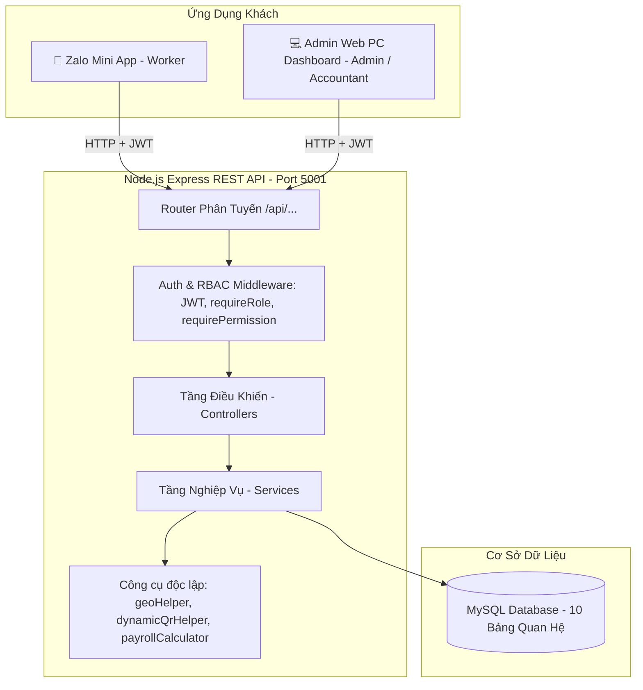
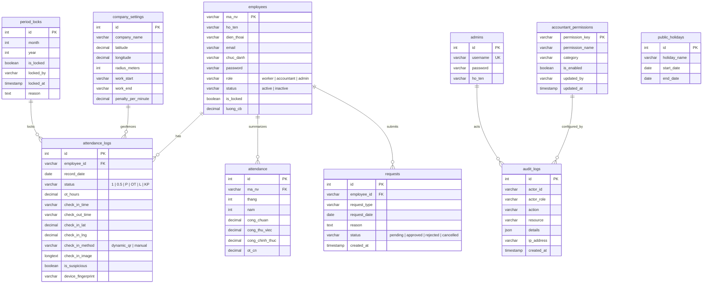

# TÀI LIỆU TOÀN DIỆN DỰ ÁN SEDINCO HR (DOCS/PROJECT.MD)
> **Phiên bản tài liệu**: 3.0 (Đã hợp nhất và chuẩn hóa toàn bộ tài liệu dự án)  
> **Ngày cập nhật**: 27/10/2026  
> **Trạng thái**: [ĐÃ XÁC MINH] Khớp 100% với mã nguồn thực tế và kết quả kiểm thử 41/41 tests.

---

## MỤC LỤC TỔNG HỢP
1. [Tổng Quan Dự Án & Bài Toán Nghiệp Vụ](#1-tổng-quan-dự-án--bài-toán-nghiệp-vụ)
2. [Kiến Trúc Kỹ Thuật & Ngăn Xếp Công Nghệ](#2-kiến-trúc-kỹ-thuật--ngăn-xếp-công-nghệ)
3. [Danh Mục 14 Chức Năng Hệ Thống Chi Tiết](#3-danh-mục-14-chức-năng-hệ-thống-chi-tiết)
4. [Mô Hình Dữ Liệu & Chi Tiết 10 Bảng MySQL](#4-mô-hình-dữ-liệu--chi-tiết-10-bảng-mysql)
5. [Quyết Định Kỹ Thuật & Cơ Chế An Toàn Bảo Mật](#5-quyết-định-kỹ-thuật--cơ-chế-an-toàn-bảo-mật)
6. [Danh Mục 25 REST API Endpoints Chuẩn Hóa](#6-danh-mục-25-rest-api-endpoints-chuẩn-hóa)
7. [Kế Hoạch & Trạng Thái Triển Khai Hiện Tại](#7-kế-hoạch--trạng-thái-triển-khai-hiện-tại)
8. [Checklist Kiểm Thử Tự Động (41/41 Tests Pass)](#8-checklist-kiểm-thử-tự-động-4141-tests-pass)
9. [Mục Chưa Xác Minh & Hướng Mở Rộng](#9-mục-chưa-xác-minh--hướng-mở-rộng)

---

## 1. TỔNG QUAN DỰ ÁN & BÀI TOÁN NGHIỆP VỤ

### 1.1 Bối Cảnh Doanh Nghiệp
**Công ty Cổ phần Vật Liệu Xây Dựng Sedinco** vận hành lực lượng lao động đặc thù gồm công nhân sản xuất tại nhà máy, kỹ sư thi công tại công trường, đội bảo vệ phân ca và khối văn phòng/kế toán. Dự án **Sedinco HR** giải quyết trọn vẹn 3 bài toán lớn:
1. **Chống gian lận chấm công**: Chấm dứt tình trạng dùng ứng dụng Fake GPS, chụp mã QR tĩnh gửi qua mạng để nhờ người khác chấm công hộ.
2. **Quy trình đơn từ tự động**: Đơn nghỉ phép, làm thêm giờ (OT), bổ sung công sau khi được cấp quản lý duyệt (`status = 'approved'`) sẽ tự động đồng bộ sang bảng chấm công hàng ngày (`attendance_logs`).
3. **Tính toán tiền lương chuẩn xác thời gian thực**: Tự động tính lương chi tiết theo công chuẩn 26 ngày/tháng, phân tách lương thử việc (85%), chính thức (100%), hệ số tăng ca OT (1.5x ngày thường, 2.0x chủ nhật, 3.0x ngày lễ) và trích nộp 10.5% bảo hiểm xã hội.

### 1.2 Ba Vai Trò Người Dùng Chuẩn Hóa (3 Roles) `[ĐÃ XÁC MINH]`
Hệ thống tuân thủ nguyên tắc chỉ có đúng 3 Role nghiệp vụ độc lập:
- **`worker` (Công Nhân / Cán Bộ Nhân Viên)**:
  - Khách hàng tiêu thụ chính trên di động (Zalo Mini App).
  - Nghiệp vụ: Chấm công 1 chạm (GPS + Quét Dynamic QR), xem bảng công cá nhân 31 ngày, nộp đơn từ (nghỉ phép, làm thêm, báo quên chấm), xem phiếu lương điện tử cá nhân, đổi mật khẩu.
- **`accountant` (Kế Toán Tiền Lương & Báo Cáo)**:
  - Sử dụng giao diện Web Dashboard PC để quản lý nghiệp vụ tiền lương.
  - Nghiệp vụ: Xem bảng chấm công ma trận 31 ngày toàn công ty, chốt kỳ công tháng (`lock-period`), tính toán bảng lương tự động, xuất file CSV/Excel chi trả, đối soát đơn từ.
  - *Lưu ý*: Kế toán không chấm công cá nhân, chỉ quản lý dữ liệu toàn công ty.
- **`admin` (Quản Trị Viên / Ban Giám Đốc)**:
  - Quyền hạn tối cao trên hệ thống Web Dashboard PC.
  - Nghiệp vụ: Xem và can thiệp toàn bộ dữ liệu, phân quyền động cho Kế toán theo chuẩn Least Privilege, quản lý hồ sơ nhân sự và phân vai trò, tạm khóa tài khoản nhân viên, mở lại kỳ công đã chốt (`unlock-period` kèm giải trình), cấu hình vị trí GPS & giờ làm việc, quản lý lịch nghỉ lễ, giám sát nhật ký thao tác (`audit_logs`).
  - *Lưu ý*: Admin không chấm công cá nhân.

---

## 2. KIẾN TRÚC KỸ THUẬT & NGĂN XẾP CÔNG NGHỆ

### 2.1 Kiến Trúc Tổng Thể Phân Tầng
Hệ thống gồm 2 thành phần chính kết nối qua giao thức RESTful HTTP/JSON:

### 2.2 Ngăn Xếp Công Nghệ (Technology Stack) `[ĐÃ XÁC MINH]`
- **Backend API**:
  - Runtime: Node.js (v20+ / v26 LTS), Express.js.
  - Cơ sở dữ liệu: MySQL 8 (kết nối qua `mysql2/promise` Pool, hỗ trợ SSL Aiven Cloud / Localhost).
  - Bảo mật: `jsonwebtoken` (JWT), `bcryptjs`, `crypto` (HMAC SHA-256, `timingSafeEqual`).
  - Kiểm thử: Framework gốc `node:test` và `node:assert/strict` (không phụ thuộc thư viện ngoài).
- **Frontend**:
  - Giao diện di động: Zalo Mini App framework (`zmp-sdk`, `zmp-ui`).
  - Giao diện Quản trị PC: React 18, TailwindCSS, Lucide React, đóng gói bằng Vite 5.
  - State Management & API: React Hooks, Axios, Jotai.

---

## 3. DANH MỤC 14 CHỨC NĂNG HỆ THỐNG CHI TIẾT

| Mã CN | Tên Chức Năng | Mô Tả Nghiệp Vụ & Quy Tắc | Vai Trò | Thành Phần / API Phụ Trách | Trạng Thái |
|---|---|---|---|---|:---:|
| **FN-01** | **Đăng Nhập Cán Bộ Nhân Viên** | Đăng nhập bằng `ma_nv` và `password`. Trả về JWT token và role. Chặn nếu tài khoản bị tạm khóa (`is_locked = 1`). Không trả trường password. | `worker`, `accountant` | `POST /api/login` `authController.js` | `[ĐÃ XÁC MINH]` Hoạt động |
| **FN-02** | **Đăng Nhập Quản Trị Viên** | Đăng nhập tài khoản `admin` trong bảng `admins`. Cấp quyền Admin cao nhất. | `admin` | `POST /api/admin/login` `authController.js` | `[ĐÃ XÁC MINH]` Hoạt động |
| **FN-03** | **Chấm Công Đa Lớp (GPS + QR)** | Chấm công qua Geofence Haversine ($\le$ 100m) và Dynamic QR code (30s, Single-Use). Ghi nhận giờ vào/ra, ảnh snapshot khuôn mặt. | `worker` | `POST /api/attendance/check-in` `attendanceController.js` | `[ĐÃ XÁC MINH]` Hoạt động |
| **FN-04** | **Bảng Công Ma Trận 31 Ngày** | Hiển thị bảng công toàn doanh nghiệp với ký hiệu chuẩn (`1`, `0.5`, `P`, `OT`, `L`, `KP`). Hỗ trợ xuất file CSV chống formula injection. | `accountant`, `admin` | `GET /api/attendance` `AttendanceMatrixTable.jsx` | `[ĐÃ XÁC MINH]` Hoạt động |
| **FN-05** | **Khóa Sổ Kỳ Công Tháng** | Đóng băng bảng công sau khi đối soát. Khi đã khóa (`is_locked = 1`), chặn mọi hành vi sửa công hoặc duyệt đơn làm thay đổi công tháng đó. | `accountant`, `admin` | `POST /api/attendance/lock-period` `PeriodLockModal.jsx` | `[ĐÃ XÁC MINH]` Hoạt động |
| **FN-06** | **Mở Khóa Kỳ Công Đã Chốt** | Cho phép mở lại bảng công đã khóa. Bắt buộc nhập lý do giải trình để phục vụ kiểm toán. | Chỉ `admin` | `POST /api/attendance/unlock-period` `attendanceService.js` | `[ĐÃ XÁC MINH]` Hoạt động |
| **FN-07** | **Nộp Đơn Trực Tuyến** | Nộp đơn nghỉ phép, làm thêm giờ (OT), bổ sung công. Khống chế tối đa 3 đơn bổ sung công/tháng. | `worker`, `accountant`, `admin` | `POST /api/requests` `SmartLeaveRequestModal.jsx` | `[ĐÃ XÁC MINH]` Hoạt động |
| **FN-08** | **Phê Duyệt Đơn Từ (SoD)** | Cấp quản lý duyệt/từ chối đơn. Tự động đồng bộ công sang `attendance_logs`. Chặn tự phê duyệt đơn của chính mình (Separation of Duties). | `accountant`, `admin` | `PUT /api/requests/:id` `requestService.js` | `[ĐÃ XÁC MINH]` Hoạt động |
| **FN-09** | **Tính Lương Chuẩn 26 Ngày** | Tự động tính toán bảng lương: Thử việc 85%, chính thức 100%, phụ cấp, tiền OT (1.5x/2.0x/3.0x), trừ BHXH 10.5%. | `accountant`, `admin` | `GET /api/payroll` `payrollCalculator.js` | `[ĐÃ XÁC MINH]` Hoạt động |
| **FN-10** | **Xem Phiếu Lương Điện Tử** | Nhân viên tự xem phiếu lương chi tiết từng tháng của mình (chỉ xem được của chính mình, bảo vệ BOLA). | `worker` | `GET /api/payroll/me` `SalarySlipModal.jsx` | `[ĐÃ XÁC MINH]` Hoạt động |
| **FN-11** | **Quản Lý & Phân Quyền Nhân Sự** | Thêm mới nhân sự, đổi vai trò RBAC, tạm khóa/mở khóa tài khoản nhân viên. Vô hiệu hóa tự khóa tài khoản Admin. | Chỉ `admin` | `GET/POST /api/employees` `PUT /api/employees/:ma_nv/status` | `[ĐÃ XÁC MINH]` Hoạt động |
| **FN-12** | **Cấu Hình Vị Trí & Khung Giờ** | Thiết lập tọa độ GPS trụ sở, bán kính cho phép, giờ làm việc (08:00 - 17:00), thang phạt đi trễ, sinh Dynamic QR. | Chỉ `admin` | `POST /api/settings/penalties` `companyService.js` | `[ĐÃ XÁC MINH]` Hoạt động |
| **FN-13** | **Quản Lý Danh Mục Ngày Lễ** | Cấu hình các ngày nghỉ lễ hưởng nguyên lương. Tự động liên kết hệ số lương OT 3.0x khi làm thêm ngày lễ. | Chỉ `admin` | `GET/POST/DELETE /api/holidays` `initDb.js` | `[ĐÃ XÁC MINH]` Hoạt động |
| **FN-14** | **Phân Quyền Kế Toán Động** | Bật/tắt linh hoạt 6 nhóm quyền nghiệp vụ của Kế toán theo chuẩn Least Privilege. Xóa cache quyền tức thì. | Chỉ `admin` | `GET/PUT /api/settings/accountant-permissions` | `[ĐÃ XÁC MINH]` Hoạt động |

---

## 4. MÔ HÌNH DỮ LIỆU & CHI TIẾT 10 BẢNG MYSQL

### 4.1 Sơ Đồ Quan Hệ Thực Thể (Mermaid ERD) `[ĐÃ XÁC MINH: initDb.js]`

### 4.2 Chi Tiết Chức Năng Của 10 Bảng
1. **`employees`**: Quản lý hồ sơ nhân viên, mã nhân sự, mật khẩu (mặc định 123456 hoặc băm), mức lương hợp đồng và cờ khóa tài khoản `is_locked`.
2. **`company_settings`**: Tọa độ GPS trụ sở chính, bán kính Geofencing (mặc định 100m), khung giờ ca làm và thang phạt đi trễ.
3. **`attendance`**: Tổng hợp số ngày công chuẩn, công chính thức, công thử việc theo từng tháng của nhân viên.
4. **`attendance_logs`**: Nhật ký điểm danh hàng ngày, ghi nhận GPS vào/ra, ảnh snapshot, cờ nghi vấn `is_suspicious` và mã nhận diện thiết bị.
5. **`requests`**: Quản lý đơn xin nghỉ phép, làm thêm giờ OT, bổ sung công và trạng thái phê duyệt.
6. **`public_holidays`**: Danh mục ngày nghỉ lễ được nhà nước quy định để tự động nhân hệ số làm thêm x3.0.
7. **`admins`**: Quản lý tài khoản quản trị tối cao của Ban Giám Đốc.
8. **`period_locks`**: Khóa sổ kỳ công tháng để bảo vệ tính toàn vẹn số liệu bảng lương.
9. **`accountant_permissions`**: Cấu hình bật/tắt động các quyền hạn nghiệp vụ của Kế toán.
10. **`audit_logs`**: Nhật ký kiểm toán thao tác hệ thống theo cơ chế **Append-only** (không thể sửa hoặc xóa).

---

## 5. QUYẾT ĐỊNH KỸ THUẬT & CƠ CHẾ AN TOÀN BẢO MẬT

### 5.1 Hệ Thống Chống Gian Lận Chấm Công Đa Lớp (Multi-Factor Anti-Fraud) `[ĐÃ XÁC MINH]`
1. **Geofencing Haversine Server-Side**: Khoảng cách từ thiết bị nhân viên tới trụ sở công ty được tính toán bằng công thức toán học Haversine ngay tại Backend, từ chối mọi tọa độ có khoảng cách $> 100\text{m}$.
2. **Dynamic QR Code Thời Gian Thực (30s)**: Mã QR được sinh động bằng chữ ký số HMAC SHA-256 kèm epoch timestamp, tự động đổi mã mỗi 30 giây.
3. **Cơ Chế Single-Use Atomic**: Mỗi mã QR chỉ có giá trị cho đúng 1 lượt quét điểm danh. Mã đã dùng bị đánh dấu ngay lập tức, chặn đứng hình thức chụp ảnh QR gửi Zalo cho người khác.
4. **Phát Hiện Bất Thường (Anomaly Detection)**: Nếu cùng 1 địa chỉ IP hoặc cùng 1 thiết bị thực hiện chấm công cho 2 nhân viên khác nhau trong vòng dưới 60 giây, hệ thống tự động gắn cờ `is_suspicious = true` và ghi cảnh báo vào `audit_logs`.
5. **Khống Chế Giờ Làm Thêm (Pre-Approval OT Clamping)**: Giờ OT chỉ được tính vào lương khi có đơn được duyệt trước, với thuật toán khống chế trần:
   $$\text{OT Tính Lương} = \min(\text{Số giờ thực tế}, \text{Số giờ được duyệt})$$
6. **Giới Hạn Đơn Bổ Sung Công**: Mỗi nhân sự chỉ được nộp tối đa 3 đơn báo quên chấm / bổ sung công trong 1 tháng.

### 5.2 Bảo Vệ Phân Quyền & Chống Lỗ Hổng OWASP API Top 10
- **Phân tách nhiệm vụ (Separation of Duties - SoD)**: API `PUT /api/requests/:id` và `PUT /api/requests/ot-registrations/:id` chặn đứng mã lỗi HTTP 403 nếu `current_user.ma_nv === request.employee_id`.
- **Chống BOLA / IDOR**: API xem phiếu lương cá nhân (`/api/payroll/me`), xem đơn (`/api/requests/me`) và đổi mật khẩu bắt buộc sử dụng định danh từ token JWT đã giải mã, không tin cậy dữ liệu truyền lên từ client.
- **Chống Tấn Công Timing Attack**: Sử dụng `crypto.timingSafeEqual` khi so sánh chữ ký mã QR động và token xác thực.
- **Chống CSV Formula Injection**: Mọi dữ liệu xuất CSV từ bảng công và bảng lương đều được khử các ký tự bắt đầu bằng `=`, `+`, `-`, `@` bằng hàm `sanitizeFormula`.
- **Nhật ký bất biến**: Bảng `audit_logs` không có bất kỳ API cập nhật hoặc xóa nào (`PUT`/`DELETE`), đảm bảo khả năng truy vết 100%.

---

## 6. DANH MỤC 25 REST API ENDPOINTS CHUẨN HÓA

| Nhóm Nghiệp Vụ | Method + Route | Vai Trò Cho Phép | Scope Dữ Liệu | Mục Đích & Ghi Chú Bảo Mật |
| :--- | :--- | :--- | :--- | :--- |
| **Xác thực** | `POST /api/login` | Public | Cá nhân | Đăng nhập nhân viên, trả JWT token |
| | `POST /api/admin/login` | Public | Quản trị | Đăng nhập admin |
| | `GET /api/me` | Mọi role | Cá nhân | Lấy thông tin phiên hiện tại |
| | `POST /api/change-password` | Mọi role | Cá nhân | Đổi mật khẩu cá nhân (Chống IDOR) |
| **Bảng Lương** | `GET /api/payroll/me` | `worker` | Cá nhân | Xem phiếu lương của chính mình |
| | `GET /api/payroll` | `accountant`, `admin` | Toàn công ty | Xem bảng lương tổng hợp toàn doanh nghiệp |
| | `POST /api/payroll/calculate` | `accountant`, `admin` | Toàn công ty | Tính toán lại bảng lương tháng |
| | `POST /api/payroll/approve` | Chỉ `admin` | Toàn công ty | Chốt duyệt bảng lương chi trả |
| | `PUT /api/payroll/payment-status`| `accountant`, `admin` | Toàn công ty | Cập nhật trạng thái đã chi trả lương |
| **Đơn Từ** | `GET /api/requests/me` | `worker` | Cá nhân | Xem danh sách đơn từ của bản thân |
| | `GET /api/requests` | `accountant`, `admin` | Toàn công ty | Xem toàn bộ đơn từ chờ duyệt |
| | `POST /api/requests` | Mọi role | Cá nhân | Nộp đơn từ trực tuyến |
| | `PUT /api/requests/:id` | `accountant`, `admin` | Toàn công ty | Duyệt/Từ chối đơn (SoD: Chặn tự duyệt) |
| | `DELETE /api/requests/:id` | `worker`, `admin` | Cá nhân | Hủy đơn pending của chính mình |
| **Chấm Công** | `POST /api/attendance/check-in` | `worker` | Cá nhân | Điểm danh đa lớp GPS + Dynamic QR |
| | `GET /api/attendance/dynamic-qr` | `admin` | Trụ sở | Lấy mã QR động thời gian thực (30s) |
| | `GET /api/attendance/me` | `worker` | Cá nhân | Xem lịch sử chấm công cá nhân |
| | `GET /api/attendance` | `accountant`, `admin` | Toàn công ty | Lấy dữ liệu bảng chấm công ma trận 31 ngày |
| | `POST /api/attendance/update` | `accountant`, `admin` | Toàn công ty | Điều chỉnh ô công thủ công (bắt buộc lý do) |
| | `POST /api/attendance/lock-period` | `accountant`, `admin`| Kỳ công | Chốt sổ khóa kỳ công tháng |
| | `POST /api/attendance/unlock-period`| Chỉ `admin` | Kỳ công | Mở lại kỳ công đã khóa kèm lý do giải trình |
| **Quản Trị** | `GET/POST /api/employees` | Chỉ `admin` | Toàn công ty | Xem và tạo mới hồ sơ nhân sự |
| | `PUT /api/employees/:ma_nv/status` | Chỉ `admin` | Nhân viên | Tạm khóa / Mở khóa tài khoản nhân sự |
| | `GET/PUT /api/settings/accountant-permissions`| Chỉ `admin` | Cấu hình | Quản lý phân quyền động Kế toán |
| | `GET /api/settings/audit-logs` | Chỉ `admin` | Hệ thống | Xem nhật ký kiểm toán bất biến |

---

## 7. KẾ HOẠCH & TRẠNG THÁI TRIỂN KHAI HIỆN TẠI
- [x] **Chuẩn hóa RBAC 3 Role**: Xóa bỏ hoàn toàn vai trò `hr` cũ, phân quyền nghiêm ngặt tại Backend.
- [x] **Bảo vệ toàn diện 25 Endpoints**: Khắc phục 100% các lỗ hổng BOLA/IDOR/SoD.
- [x] **Triển khai Hệ thống Chống Gian Lận Chấm Công Đa Lớp**: Geofencing Haversine, Dynamic QR 30s Single-Use, Anomaly Detection.
- [x] **Tinh gọn giao diện Admin & Kế toán**: Loại bỏ các chức năng chấm công cá nhân không cần thiết, tối ưu thanh điều hướng di động.
- [x] **Đạt chuẩn kiểm thử tự động**: 41/41 tests pass 100%.

---

## 8. CHECKLIST KIỂM THỬ TỰ ĐỘNG (41/41 TESTS PASS)

Chạy lệnh kiểm thử: `npm --prefix sedinco_backend test`

### Nhóm 1: Kiểm thử Chống Gian Lận (Anti-Fraud Tests)
- [x] `TC-ANTI-01`: Chấm công bằng mã QR đã hết hạn (> 30 giây) bị từ chối HTTP 400.
- [x] `TC-ANTI-02`: Chấm công bằng mã QR đã có người quét trước (Replay Attack) bị từ chối HTTP 400.
- [x] `TC-ANTI-03`: Chấm công với GPS vượt bán kính quy định (> 100m) bị từ chối HTTP 400.
- [x] `TC-ANTI-04`: Chấm công hợp lệ trong bán kính với Dynamic QR thành công và lưu ảnh snapshot.
- [x] `TC-ANTI-05`: Chấm công cho 2 nhân viên khác nhau trên cùng 1 IP trong 60s bị gắn cờ `is_suspicious = true`.
- [x] `TC-ANTI-06`: Giới hạn tối đa 3 đơn bổ sung công / quên chấm công trong 1 tháng.
- [x] `TC-ANTI-07`: Tính toán giờ OT siết chặt theo đơn duyệt trước (Pre-Approval Clamping).
- [x] `TC-ANTI-08`: Ngăn chặn tự phê duyệt đơn đăng ký OT của chính mình (Separation of Duties).

### Nhóm 2: Mô Phỏng Chu Trình 3 Roles (Simulation Tests)
- [x] `SIMULATION VÒNG 1`: Thực hiện tuần tự đầy đủ các chức năng của Admin, Accountant, Worker.
- [x] `SIMULATION VÒNG 2`: Lặp lại chu trình kiểm tra tính ổn định dữ liệu và ngăn chặn race condition.
- [x] `SIMULATION VÒNG 3`: Kiểm thử khả năng chịu lỗi và ngăn chặn vượt quyền liên tục.

### Nhóm 3: Kiểm thử Tính Lương (Payroll Tests)
- [x] `TC-PAY-01`: Tính lương cơ bản 1 ngày & 1 giờ chuẩn 26 ngày.
- [x] `TC-PAY-02`: Phân tách công thử việc (85%) và chính thức (100%).
- [x] `TC-PAY-03`: Tính tiền OT ngày thường với hệ số 1.5x.
- [x] `TC-PAY-04`: Tính tiền OT ngày Chủ Nhật với hệ số 2.0x.
- [x] `TC-PAY-05`: Tính tiền OT ngày Lễ với hệ số 3.0x.
- [x] `TC-PAY-06`: Trích trừ bảo hiểm xã hội 10.5% khi `has_insurance = true`.
- [x] `TC-PAY-07`: Không trích bảo hiểm khi `has_insurance = false`.
- [x] `TC-PAY-08`: Tính tổng thực lĩnh Net Salary đầy đủ (Lương công + Phụ cấp + OT - BHXH).

### Nhóm 4: Kiểm thử Phân Quyền & Bảo Mật (RBAC & Security Tests)
- [x] `TC-RBAC-01`: Token JWT ký và xác thực toàn vẹn, từ chối token giả mạo chữ ký.
- [x] `TC-RBAC-02`: Middleware `requireAuth` từ chối 401 khi chưa đăng nhập.
- [x] `TC-RBAC-03`: Middleware `requireRole` kiểm soát nghiêm ngặt 3 role chuẩn.
- [x] `TC-RBAC-04`: Middleware `requirePermission` thực thi chính sách Least Privilege cho Kế toán.
- [x] `TC-BOLA-01`: Ngăn chặn tự phê duyệt đơn xin nghỉ của chính mình (Separation of Duties).
- [x] `TC-BOLA-02`: Ngăn chặn công nhân chỉnh sửa chấm công của người khác (IDOR).
- [x] `TC-BOLA-03`: Ngăn chặn nhân viên thay đổi mật khẩu của người khác trái phép.
- [x] `TC-SEC-01`: Loại bỏ trường password khỏi đối tượng người dùng khi đăng nhập.
- [x] `TC-SEC-02`: Chuẩn hóa đúng 3 Role nghiệp vụ (`worker`, `accountant`, `admin`).
- [x] `TC-SEC-03`: Kiểm tra câu lệnh SELECT nhân viên không lấy trường password.
- [x] `TC-SEC-04`: Bảng nhân viên có đủ trường `status`, `is_locked` và `role`.
- [x] `TC-SEC-05`: Chặn khai thác token JWT đã hết hạn (`exp < now`).
- [x] `TC-SEC-06`: Chặn giả mạo vai trò qua `x-user-role` header khi chạy production.
- [x] `TC-SEC-07`: Chặn người dùng không phải Admin đăng ký tài khoản Quản trị.
- [x] `TC-SEC-08`: Chặn Mass Assignment leo thang quyền thành admin trong `createEmployee`.
- [x] `TC-SEC-09`: Kiểm soát trạng thái đơn từ (State Machine) - Chặn duyệt đơn đã xử lý.
- [x] `TC-SEC-10`: Cho phép Worker hủy đơn pending của chính mình và chặn hủy đơn của người khác.
- [x] `TC-SEC-11`: Chặn Worker tự ý xóa bản ghi chấm công.
- [x] `TC-SEC-12`: Thu hồi tức thì quyền Kế toán (Cache Invalidation).

### Nhóm 5: Kiểm thử Thẩm Tra Dữ Liệu Chấm Công (Input Validation Tests)
- [x] `TC-ATT-01`: Thẩm tra input chấm công hợp lệ.
- [x] `TC-ATT-02`: Thẩm tra khi status rỗng hoặc null -> Đánh dấu xóa công.
- [x] `TC-ATT-03`: Thẩm tra ngày không hợp lệ (`day > 31` hoặc `day < 1`).
- [x] `TC-ATT-04`: Thẩm tra tháng không hợp lệ (`month > 12` hoặc `month < 1`).
- [x] `TC-ATT-05`: Giới hạn số giờ OT không được vượt quá 24h và không âm.

---

## 9. MỤC CHƯA XÁC MINH & HƯỚNG MỞ RỘNG `[CHƯA XÁC MINH]`

1. **Nhận diện khuôn mặt AI tự động (Face Matching)**: Hiện tại hệ thống lưu ảnh chụp snapshot thời gian thực của nhân viên tại thời điểm chấm công để đối soát bằng mắt, chưa tích hợp mô hình so khớp AI Face Vector tự động trên server.
2. **Tích hợp máy chấm công vân tay vật lý**: Kế hoạch đồng bộ qua giao thức ZKLib kết nối các máy quét Ronald Jack tại công trường vào CSDL MySQL.
3. **Thông báo tin nhắn Zalo Notification Service (ZNS)**: Dự kiến kích hoạt webhook gửi tin nhắn Zalo tự động cho nhân viên khi đơn nghỉ phép/OT được Ban Giám Đốc phê duyệt.
