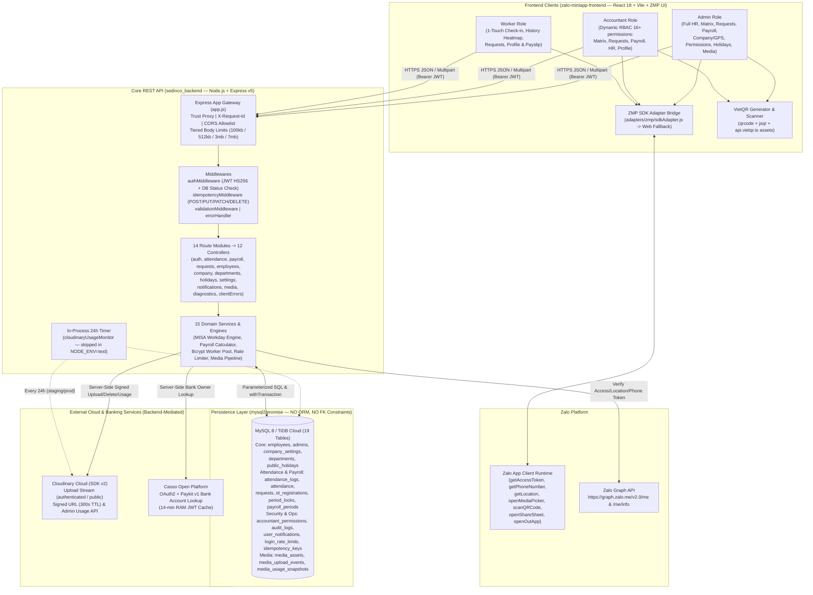
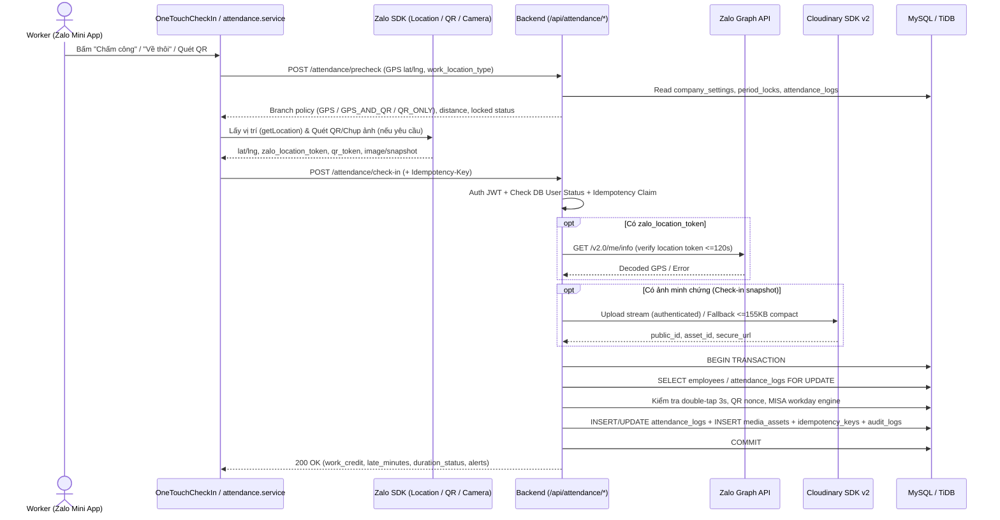
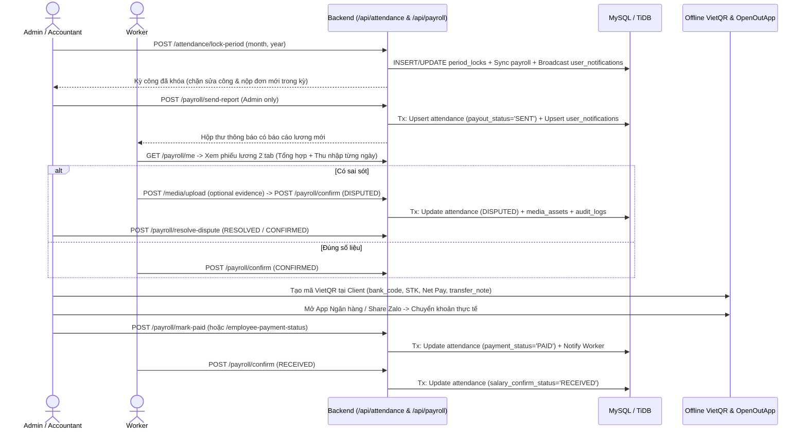

# SEDINCO HR — SYSTEM ARCHITECTURE MAP (PHASE 1)

Tài liệu này mô tả bản đồ kiến trúc hệ thống thực tế dựa trên mã nguồn hiện hữu (`main` @ `f648470`), bao gồm toàn bộ các thành phần đang chạy và ghi rõ những thành phần không sử dụng.

> **Xác nhận hạ tầng không tồn tại trong kiến trúc hiện tại:**  
> - **Redis:** Không có (Rate limit & Idempotency lưu trên MySQL/TiDB + Map RAM nội bộ tiến trình).  
> - **Socket.IO / WebSocket:** Không có (Thông báo & cảnh báo dùng HTTP GET đồng bộ khi mở app/tab).  
> - **Email / SMTP:** Không có.  
> - **Prisma / ORM:** Không có (Truy vấn SQL thuần tham số hóa qua `mysql2/promise`).

---

## 1. Sơ đồ kiến trúc tổng quan (Component & Integration Flow)

---

## 2. Luồng nghiệp vụ xuyên suốt (End-to-End Sequence Diagrams)

### 2.1 Luồng Chấm công đa lớp & Lưu minh chứng Cloudinary (Smart Attendance + Media)

### 2.2 Luồng Khóa kỳ -> Phát phiếu lương -> Khiếu nại / Thanh toán VietQR

---

## 3. Ranh giới an toàn & Chính sách Triển khai Hiện tại

- **Trust Boundary 1 (Zalo Client vs Backend):** Frontend tuyệt đối không giữ `ZALO_APP_SECRET`, `CASSO_APP_SECRET`, `CLOUDINARY_API_SECRET`, `JWT_SECRET`, `QR_SECRET`. Mọi xác minh token Zalo, tra cứu Casso, ký URL Cloudinary và tính lương chính thức đều nằm ở Backend.
- **Trust Boundary 2 (Client Upload vs Media Storage Policy):** Client chỉ gửi file buffer (`multipart/form-data`) và category; Backend quyết định `asset_folder`, `public_id`, `delivery_type` (`authenticated` cho chứng từ/ảnh chấm công/đơn từ/khiếu nại, `upload` cho avatar/logo), giới hạn kích thước và chống thực thi qua `mediaValidator.js`.
- **Trust Boundary 3 (Test vs Production DB Isolation):** `sedinco_backend/src/config/db.js` chặn cứng mọi cấu hình `NODE_ENV=test` nếu host chứa `aivencloud.com`, `tidbcloud.com`, `render.com`, bật `DB_SSL=true`, hoặc tên DB không chứa `test`. Staging/Production tắt Runtime DDL (`verifySchemaReadiness` yêu cầu chạy `scripts/migrate_staging_schema.js` trước bằng tài khoản migration).
