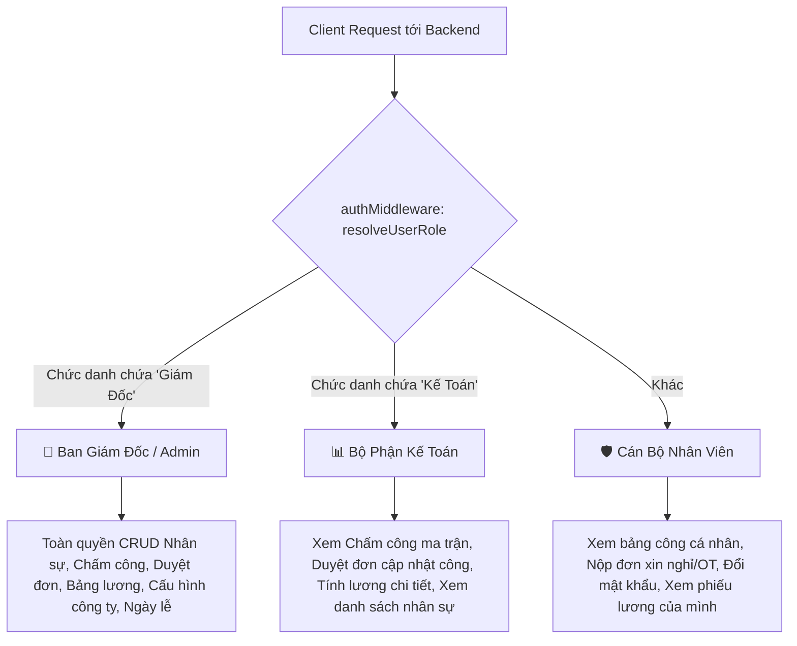
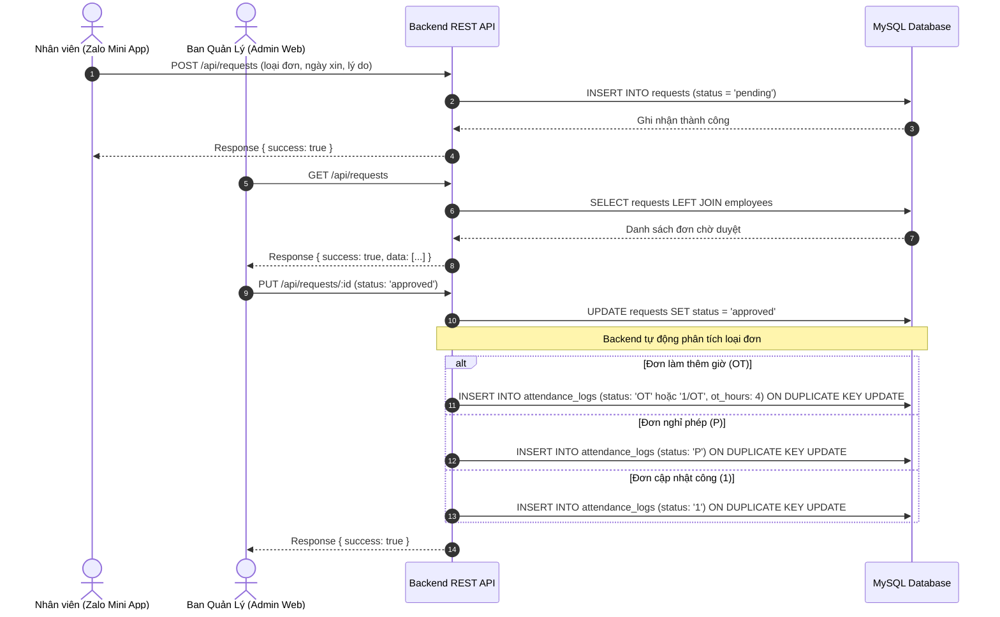
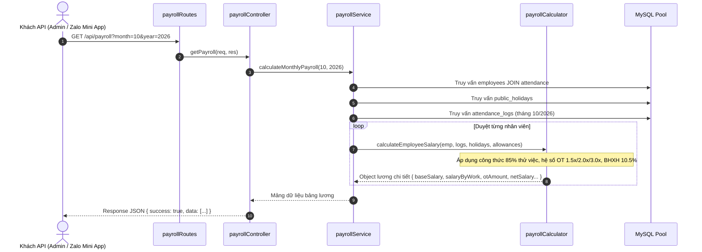

# Tổng Quan Nghiệp Vụ Hệ Thống Backend — Sedinco HR
*(Hệ Thống Dịch Vụ Máy Chủ Quản Lý Chấm Công & Tiền Lương Doanh Nghiệp)*

---

## 1. Bối Cảnh & Bài Toán Nghiệp Vụ Backend Giải Quyết

Công ty Cổ phần Vật Liệu Xây Dựng Sedinco quản lý lực lượng lao động đa dạng: kỹ sư công trường, công nhân sản xuất, nhân viên bảo vệ và khối văn phòng/kế toán.

### Thách thức trước khi có Backend tập trung:
1. **Dữ liệu phân tán & thiếu nhất quán**: Nhật ký chấm công ghi chép thủ công trên giấy hoặc file Excel rời rạc dẫn đến sai sót khi tổng hợp ngày công cuối tháng.
2. **Quy trình duyệt đơn thủ công**: Nhân viên xin nghỉ phép hoặc đăng ký làm thêm giờ (OT) bằng giấy tờ hoặc tin nhắn chat không chính thức, gây khó khăn cho kế toán khi đối soát công.
3. **Phức tạp trong tính toán tiền lương**:
   - Phân biệt ngày công thử việc (hưởng 85% lương) và ngày công chính thức (hưởng 100%).
   - Tính hệ số làm thêm giờ theo Luật Lao động: Ngày thường **1.5x**, Chủ nhật **2.0x**, Ngày lễ **3.0x**.
   - Trích nộp bảo hiểm xã hội 10.5% và khấu trừ phụ cấp theo số ngày làm việc thực tế.

### Giải pháp do Sedinco HR Backend cung cấp:
- **Dịch vụ Chấm công Ma trận**: Lưu trữ và truy xuất ma trận công của toàn bộ nhân viên theo tháng, hỗ trợ ghi nhận giờ vào (`check_in_time`) và giờ ra (`check_out_time`).
- **Quy trình Phê duyệt Tự động Đồng bộ (Auto-Sync Approval)**: Khi đơn từ được cấp quản lý duyệt (`status = 'approved'`), Backend tự động chèn/cập nhật bản ghi công tương ứng vào bảng nhật ký chấm công.
- **Công thức Tính lương Tự động Thời gian Thực (Real-time Payroll Engine)**: Tự động tính lương chi tiết cho toàn bộ nhân viên trong tháng, trả về kết quả qua API chuẩn hóa cho các ứng dụng khách.

---

## 2. Các Vai Trò Người Dùng & Phân Quyền Backend (RBAC)

Hệ thống Backend phân loại quyền hạn người dùng dựa trên thông tin định danh và chức danh công việc (`chuc_danh`):

---

## 3. Luồng Nghiệp Vụ Backend Chi Tiết (Sequence Diagrams)

### 3.1 Luồng Nộp Đơn & Tự Động Đồng Bộ Công (Request & Attendance Sync)

### 3.2 Luồng Tính Lương Tự Động (Payroll Calculation Flow)

---

## 4. Cơ Chế Chống Gian Lận Điểm Danh Tại Backend

1. **Khống chế trần số giờ làm thêm (OT Hour Clamping)**:
   - Backend không tin cậy dữ liệu client gửi lên.
   - Khi nhận tham số `ot_hours`, tầng validation tự động chặn số âm và đưa về tối đa **24 giờ/ngày** nhằm ngăn chặn gian lận hoặc tràn số liệu bảng lương.
2. **Kiểm tra tính hợp lệ của ngày tháng (Date Range Assertion)**:
   - Ngăn chặn các request giả mạo ngày không tồn tại (như ngày 32, tháng 13, năm < 2000 hoặc > 2100).
3. **Ẩn dữ liệu nhạy cảm (Zero Password Leakage)**:
   - Tất cả các endpoint trả về danh sách nhân viên hoặc thông tin người dùng đều tự động khử trường `password` trước khi gửi ra ngoài mạng.

---

## 5. Kiến Trúc Khách Hàng Đa Nền Tảng & Tiêu Chuẩn Giao Diện (Cross-Platform Frontend)

Hệ thống cung cấp trải nghiệm nhất quán trên cả thiết bị di động và máy tính để bàn thông qua một mã nguồn Frontend duy nhất kết nối trực tiếp lõi Backend REST API:

1. **Zalo Mini App (Mobile App)**:
   - Dành cho Cán bộ Công nhân viên.
   - Hỗ trợ định vị GPS bán kính công trình/nhà máy, quét khuôn mặt qua Camera, xem bảng công 31 ngày cá nhân, nộp đơn từ trực tuyến và tra cứu phiếu lương điện tử.
   - Vận hành mượt mà trên nền tảng Zalo với hiệu ứng chuyển trang `AnimationRoutes` và `ZMPRouter`.
2. **Quản Trị Web Quản Lý (Desktop PC)**:
   - Dành cho Kế Toán và Ban Giám Đốc.
   - Giao diện Widescreen với Sidebar điều hướng, Bảng công ma trận 31 ngày (click-to-edit, xuất CSV), Bảng lương doanh nghiệp tổng hợp (thẻ KPI, chiết tính bảo hiểm, xuất CSV, in phiếu chi chuẩn Sedinco).
   - Tích hợp bộ giả lập thiết bị di động (Mobile Simulator) ngay trên Web giúp người quản lý có thể xem và kiểm tra góc nhìn của nhân viên.
3. **Tiêu Chuẩn Đăng Nhập & Bảo Mật Doanh Nghiệp**:
   - Sử dụng **Logo chính thức của Công ty Cổ phần Vật Liệu Xây Dựng Sedinco** (khối lục giác cấu trúc xanh hoàng gia phối viền ánh kim và chữ "S" biểu trưng).
   - **Loại bỏ hoàn toàn mọi gợi ý tài khoản và mật khẩu**: Màn hình đăng nhập sản xuất không hiển thị các phím tắt demo hay gợi ý thông tin đăng nhập trong placeholder, đảm bảo tuân thủ nghiêm ngặt chính sách bảo mật nội bộ.

