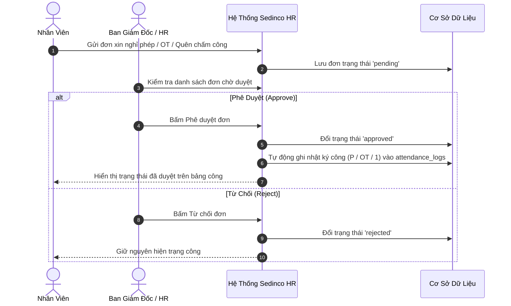
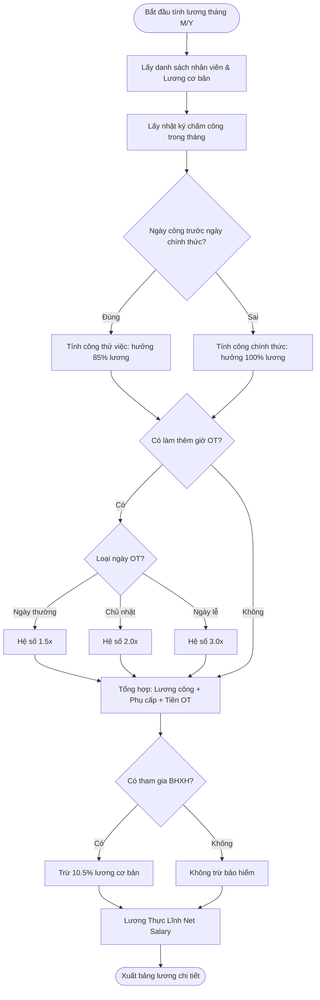

# Báo Cáo Tổng Quan Dự Án — Sedinco HR
*(Hệ Thống Quản Lý Chấm Công & Tiền Lương Doanh Nghiệp)*

---

## 1. Bối Cảnh & Vấn Đề Giải Quyết

Công ty Cổ phần Vật Liệu Xây Dựng Sedinco quản lý đội ngũ cán bộ, kỹ sư, công nhân và nhân viên bảo vệ với nhiều ca làm việc, ngày nghỉ lễ và tính chất công việc đa dạng.

### Vấn đề thực tế trước khi có hệ thống:
1. **Chấm công thủ công trên giấy/Excel**: Dễ thất lạc dữ liệu, tốn thời gian tổng hợp vào cuối tháng, dễ xảy ra sai sót khi nhân viên làm thêm giờ (OT) hoặc có ngày nghỉ phép.
2. **Quy trình xin phép cồng kềnh**: Nhân viên viết giấy xin phép hoặc nhắn tin qua nhiều kênh rời rạc, cấp quản lý khó kiểm soát và đối chiếu khi tính công.
3. **Tính lương phức tạp**: Việc phân biệt ngày thử việc (hưởng 85% lương), ngày chính thức (hưởng 100%), tính hệ số làm thêm giờ ngày thường (1.5x), Chủ nhật (2.0x), ngày lễ (3.0x) và trích nộp bảo hiểm thường mất nhiều ngày của bộ phận kế toán.

### Giải pháp của Sedinco HR:
Số hóa toàn diện quy trình nhân sự từ điểm danh hàng ngày, quản lý đơn từ phê duyệt trực tuyến, tự động tính toán bảng lương theo thời gian thực và cung cấp giao diện riêng biệt cho từng đối tượng sử dụng.

---

## 2. Đối Tượng Người Dùng & Chức Năng Theo Vai Trò

```mermaid
graph TD
    User([Người Dùng Sedinco HR]) --> RoleAdmin[👑 Ban Giám Đốc]
    User --> RoleAccountant[📊 Kế Toán]
    User --> RoleEmployee[🛡️ Cán Bộ Nhân Viên]

    RoleAdmin --> AdminF1[Tổng quan KPI & Quỹ lương]
    RoleAdmin --> AdminF2[Chấm công ma trận toàn công ty]
    RoleAdmin --> AdminF3[Phê duyệt / Từ chối đơn từ]
    RoleAdmin --> AdminF4[Quản lý bảng lương & hồ sơ nhân sự]
    RoleAdmin --> AdminF5[Cài đặt doanh nghiệp & Ngày lễ]

    RoleAccountant --> AccF1[Xem ma trận chấm công]
    RoleAccountant --> AccF2[Duyệt đơn cập nhật công]
    RoleAccountant --> AccF3[Tính toán & Xuất bảng lương]
    RoleAccountant --> AccF4[Xem danh sách nhân sự]

    RoleEmployee --> EmpF1[Xem bảng công cá nhân]
    RoleEmployee --> EmpF2[Xem phiếu lương của chính mình]
    RoleEmployee --> EmpF3[Nộp đơn xin nghỉ / Báo OT]
```

### Chi tiết quyền hạn từng nhóm:
- **Ban Giám Đốc (Admin)**: Toàn quyền quản trị cao nhất, kiểm soát chi phí quỹ lương hàng tháng, phê duyệt ngoại lệ và điều chỉnh thông tin pháp lý doanh nghiệp.
- **Kế Toán (Accountant)**: Tập trung vào đối soát ngày công, duyệt các đơn điều chỉnh công, tính toán số liệu tiền lương chi tiết, không can thiệp cấu hình hệ thống cốt lõi.
- **Cán Bộ Nhân Viên (Employee)**: Giao diện bảo mật cá nhân, chỉ theo dõi ngày công và thu nhập của riêng mình, chủ động nộp đơn xin nghỉ phép/OT trực tuyến mà không cần giấy tờ.

---

## 3. Luồng Nghiệp Vụ Chính (Business Flowcharts)

### 3.1 Luồng Chấm Công & Phê Duyệt Đơn Từ

### 3.2 Luồng Tính Toán Bảng Lương Hàng Tháng

---

## 4. Phạm Vi Hệ Thống (Scope of System)

### 4.1 Đã Có Trong Code [ĐÃ XÁC MINH]
- Đăng nhập phân quyền theo 3 vai trò (Admin, Kế toán, Nhân viên).
- Bảng ma trận chấm công 31 ngày của toàn bộ nhân viên.
- Thao tác chỉnh sửa công từng ô hoặc sửa hàng loạt (bulk edit).
- Quy trình nộp đơn và duyệt đơn tự động cập nhật công.
- Tính lương tự động theo công thức doanh nghiệp (công chuẩn 26 ngày, lương thử việc 85%, phụ cấp, OT, BHXH).
- Quản lý hồ sơ nhân viên và danh mục ngày lễ quốc gia.
- Cấu hình thông tin công ty và tải logo.

### 4.2 Chưa Có Trong Code [ĐÃ XÁC MINH LÀ CHƯA CÓ]
- Chưa có tính thuế thu nhập cá nhân (TNCN) theo biểu lũy tiến và giảm trừ gia cảnh.
- Chưa có quản lý tạm ứng lương giữa tháng và thưởng/phạt phát sinh.
- Chưa có khóa kỳ công (freeze period) để ngăn sửa số liệu tháng cũ sau khi đã chốt lương.
- Chưa có chữ ký số điện tử trên phiếu lương.

### 4.3 Ngoài Phạm Vi (Out of Scope)
- Tuyển dụng và chấm điểm phỏng vấn ứng viên.
- Quản lý tài sản, trang thiết bị bảo hộ lao động.
- Kế toán tổng hợp và kê khai thuế doanh nghiệp.

---

## 5. Công Nghệ Sử Dụng Ở Mức Dễ Hiểu

- **Giao diện Web (Frontend)**: Ứng dụng web hiện đại, tải trang tức thì, tự động tương thích với cả máy tính để bàn, máy tính bảng và điện thoại di động.
- **Máy chủ xử lý (Backend API)**: Bộ não điều phối các phép tính, tiếp nhận lệnh và trả về kết quả an toàn với tốc độ phản hồi tính bằng mili-giây.
- **Cơ sở dữ liệu (Database)**: Nơi lưu trữ thông tin nhân sự và lịch sử công được lưu trữ đám mây với đường truyền mã hóa SSL bảo mật.

---

## 6. Trạng Thái Hiện Tại & Định Hướng Nâng Cấp

- **Hiện trạng**: Hệ thống đã được hoàn thiện các tính năng nghiệp vụ cốt lõi, triển khai backend trên nền tảng Render, frontend trên Cloudflare Workers/Vercel và cơ sở dữ liệu trên Aiven Cloud.
- **Định hướng phát triển tiếp theo**:
  1. Tích hợp mã hóa mật khẩu cấp độ cao (`bcrypt`) và cơ chế xác thực Token bảo mật (`JWT`).
  2. Bổ sung tính năng Khóa sổ kỳ lương để cố định số liệu kế toán sau ngày chốt lương.
  3. Mở rộng kết nối đồng bộ trực tiếp từ máy chấm công vân tay/khuôn mặt tại nhà máy.
